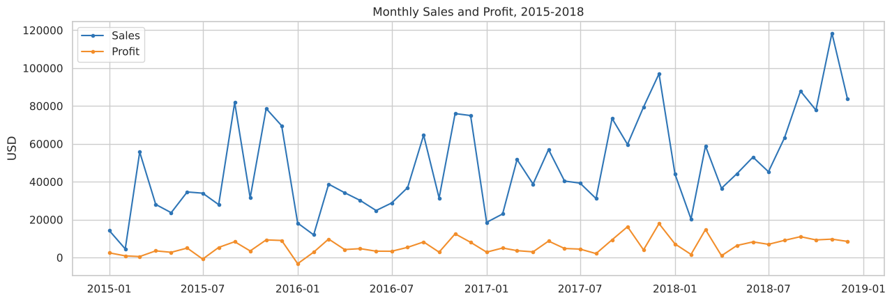
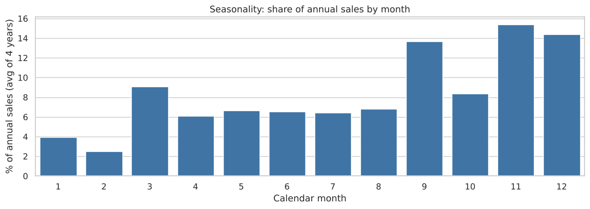
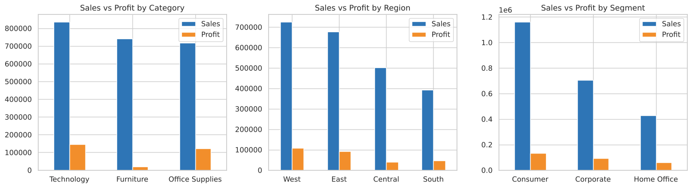
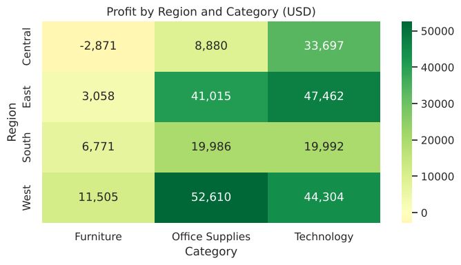
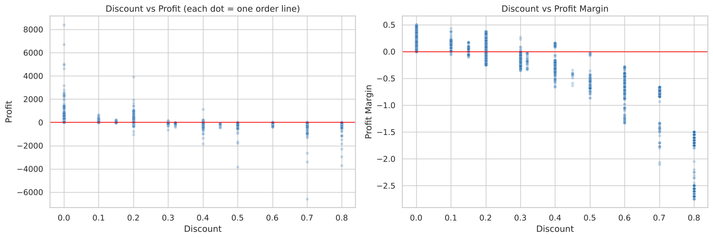
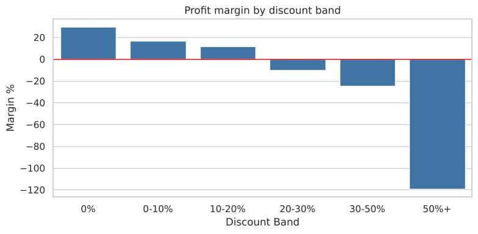

# Superstore Retail Sales: Exploratory Data Analysis

**Datheon Data Analytics & Power BI Virtual Internship, Task 1**

An exploratory analysis of four years of retail sales (2015-2018), covering customer purchase volume, monthly seasonality, category-wise revenue and discount sensitivity. The notebook cleans the raw data, profiles missing values, aggregates performance by Category, Region and Segment, and finishes with annotated business takeaways and recommendations.

## Key findings

| Metric | Result |
|---|---|
| Total sales | about $2.30M |
| Total profit | about $286K (12.5% margin) |
| Customers / orders | 793 customers, about 5,000 orders |
| Best sales year | 2018 (about $733K, +20% on 2017) |

1. **Strong seasonality.** September, November and December generate about 43% of annual sales. January and February are the weakest months.
2. **Furniture sells but does not earn.** It is 32% of sales but only a 2.5% margin, against about 17% for Technology and Office Supplies. Tables, Bookcases and Supplies lose money.
3. **Discounts above 20% destroy profit.** Margins fall from 29.5% (no discount) to -10% (20-30% discount) and -119% (50%+). About 97% of lines discounted above 20% lose money.
4. **The Central region is the weak spot.** It has the lowest margin (7.9%) and the highest average discount (24%). Texas, Ohio, Illinois and Pennsylvania are the least profitable states.
5. **Loyal, concentrated customers.** About 98% of customers order more than once, and the top 10% of customers account for about 31% of sales.

**Recommendations:** cap discounts at about 20% with approval above that, review pricing on Tables, Bookcases and Supplies, investigate discounting in the Central region, and align stock and marketing with the September to December peak.

## Selected charts








## Data cleaning highlights

- The source CSV contained **806 non-sales rows**: a People table (regional managers) and a Returns table had been appended below the transactions. These were separated out, and the returns list was kept to calculate a return rate (about 6% of orders).
- Removed 1 duplicate transaction and filled one missing postal code (Burlington).
- Parsed order and ship dates, then engineered `Year`, `Month`, `Year-Month`, `Ship Days` and `Profit Margin`.
- Validated that no ship date precedes its order date and that all discounts fall between 0% and 100%.

## Tools

Python, pandas, NumPy, Matplotlib, Seaborn, Jupyter Notebook

## Repository structure

```
.
├── README.md
├── superstore_eda.ipynb      # full analysis with outputs
├── superstore_sales.csv      # source dataset
└── images/                   # charts used in this README
```

## How to run

```bash
pip install pandas numpy matplotlib seaborn jupyter
jupyter notebook superstore_eda.ipynb
```

Keep `superstore_sales.csv` in the same folder as the notebook.

## Author

**Brian Quartey**, Data Analyst and BI Specialist
LinkedIn: <add your profile link> | GitHub: <add your GitHub link>
