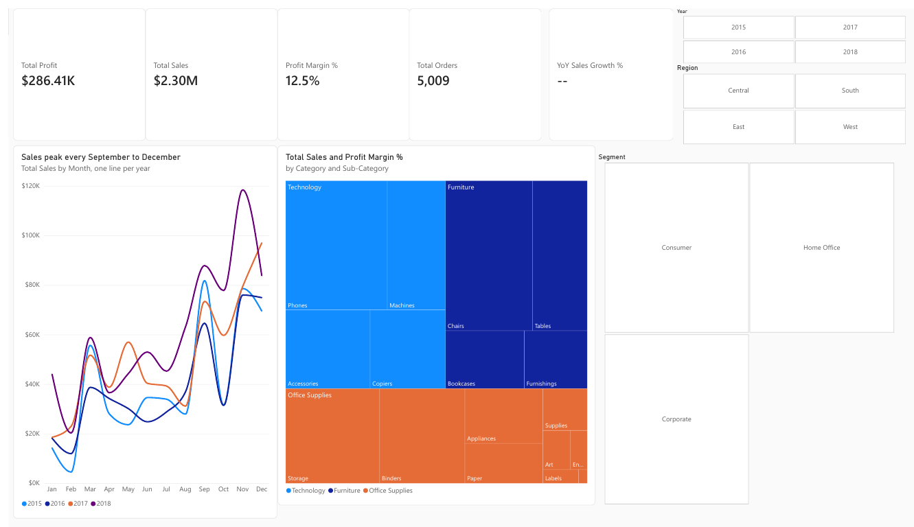
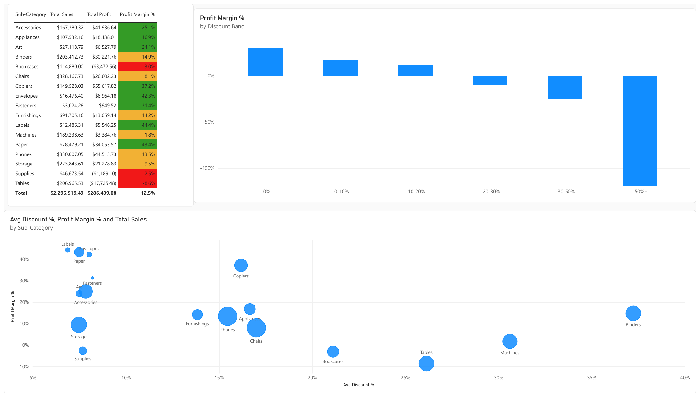
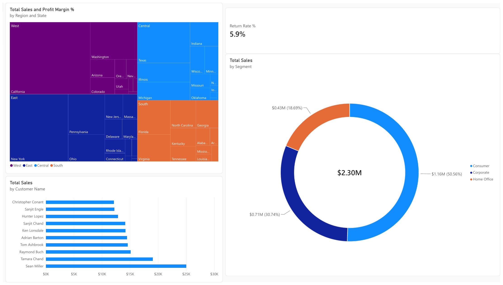

# Task 2: Interactive Power BI Executive Sales & Profit Dashboard

A three-page, interactive Power BI report built on a star schema, with DAX measures, year, region and segment slicers, and conditional formatting. It turns four years of Superstore retail transactions into an executive view of sales, profit and discount impact.

**Files:** `Superstore_Executive_Dashboard.pbix` (open in Power BI Desktop) and `Superstore_Executive_Dashboard.pdf` (full export).

## Data model (star schema)

| Table | Type | Rows | Key |
|---|---|---|---|
| `fact_orders` | Fact | 9,993 | Row ID |
| `dim_customer` | Dimension | 793 | Customer ID |
| `dim_product` | Dimension | 1,862 | Product ID |
| `dim_date` | Dimension (DAX calendar, marked as date table) | 1,461 days | Date |

Relationships are all many-to-one with single-direction filters: `fact_orders[Order Date]` to `dim_date[Date]`, `[Customer ID]` to `dim_customer`, and `[Product ID]` to `dim_product`.

**Data preparation:** the raw CSV had 806 non-sales rows (a People table and a Returns table pasted under the transactions). These were separated out, and the returns list was used to flag returned orders. One duplicate transaction was removed, one missing postal code was filled, and `Discount Band` was added. 32 Product IDs had more than one name in the source, so `dim_product` keeps the most frequent name per ID to make the key unique.

## DAX measures

`Total Sales`, `Total Profit`, `Profit Margin %`, `Total Orders`, `Total Customers`, `Total Quantity`, `Avg Order Value`, `Avg Discount %`, `Sales PY`, `Profit PY`, `YoY Sales Growth %`, `YoY Profit Growth %`, `Return Rate %`.

```DAX
Profit Margin % = DIVIDE([Total Profit], [Total Sales], 0)

Sales PY = CALCULATE([Total Sales], SAMEPERIODLASTYEAR(dim_date[Date]))

YoY Sales Growth % =
IF(
    HASONEVALUE(dim_date[Year]),
    DIVIDE([Total Sales] - [Sales PY], [Sales PY])
)
```

`YoY Sales Growth %` is blank unless a single year is selected, so it never compares an incomplete period.

## Report pages

### 1. Executive Overview
KPI cards (profit, sales, margin, orders, YoY growth), a monthly sales line chart with one line per year, and a category and sub-category treemap, with year, region and segment slicers.



### 2. Product Profitability
A sub-category matrix with red, amber and green margin rules, margin by discount band, and a scatter plot of discount against margin.



### 3. Regional & Customers
Sales and margin by region and state, the top 10 customers, the segment split and the return rate.



## Key insights

1. **Strong seasonality.** Sales rise from September and peak in November in every year, and 2018 reached about $118K in November.
2. **Discounts destroy profit.** Margin falls from 29.5% with no discount to about -10% at 20-30%, -25% at 30-50% and -119% above 50%.
3. **Furniture is the weak category.** It earns a 2.5% margin against about 17% for Technology and Office Supplies, and Tables (-8.6%), Bookcases (-3.0%) and Supplies (-2.5%) lose money.
4. **Central is the weakest region**, with a 7.9% margin and an average discount of 24%. Texas, Ohio, Illinois and Pennsylvania are the weakest states.
5. **Customers are loyal and concentrated.** The top customer, Sean Miller, bought about $25K, and Consumer is 50.6% of sales.
6. **Returns are modest**, at 5.9% of orders.

## How to open

Open `Superstore_Executive_Dashboard.pbix` in Power BI Desktop (Windows). If you rebuild it from scratch, load the three CSV files in `data/`, create `dim_date` in DAX, add the relationships and recreate the measures above.

## Tools

Power BI Desktop, DAX, Power Query, Python (data preparation)
